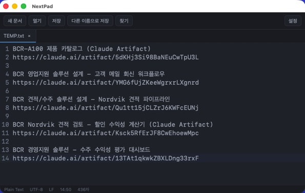

# NextPad

CodeMirror 6 + Tauri 2 기반의 가벼운 데스크톱 메모장입니다. [D09 기술명세서](<D09%20SPEC%20NextPad_Technical_SPEC_v1.0.md>)를
기반으로 하되, 핵심 편집 기능에 집중하기 위해 일부 견고성 기능(외부 변경 충돌 감지, 저장 경쟁 상태 버전 관리,
요청ID 기반 종료 코디네이터 등)을 의도적으로 생략한 경량 버전입니다. 자세한 범위는 [트임 내역](#스펙-대비-트임-내역)을
참고하세요.

## 지원 환경 및 버전

- **대상 OS**: macOS (Apple Silicon). Windows는 검증되지 않았습니다.
- **Node.js**: v24.11.1 (`.nvmrc` 참고)
- **Rust**: 1.96.1 (`src-tauri/rust-toolchain.toml` 참고)
- **Tauri**: 2.12.x (`@tauri-apps/cli`, `tauri` crate)
- **CodeMirror**: 6.x (`@codemirror/*` 패키지, `package.json` 참고)

## 핵심 기능

- 새 문서 / 파일 열기 / 저장 / 다른 이름으로 저장 (최대 탭 20개, 문서당 5MiB 제한)
- 탭별 `EditorState` 보존 — 탭 전환 시 커서·선택·실행 취소(undo/redo) 기록·스크롤 위치 유지
- 찾기/바꾸기 (일반 텍스트, 대소문자 구분 옵션 — 정규식 미지원)
- 언어별 구문 강조: Plain Text / Markdown / JSON / HTML / JavaScript (확장자 기반 자동 감지)
- 테마(라이트/다크)·글자 크기(10–28px)·자동 줄바꿈 설정, `settings.json`에 영속화
- 상태 표시줄: 언어, UTF-8/BOM 여부, LF/CRLF, 줄:열(UTF-16 코드 유닛 기준), 문자 수(Unicode 코드 포인트 기준, 디바운스)
- UTF-8 strict 검증, BOM/개행(LF·CRLF) 보존, 폴더·심볼릭 링크·바이너리·5MiB 초과 파일 거부
- 안전 저장: 대상과 같은 디렉터리에 임시 파일 작성 → flush/fsync → 원자적 교체(rename)
- 동일 경로 중복 열기 방지(기존 탭 활성화), 다른 탭이 사용 중인 경로로의 저장 차단
- 탭 닫기 / 창 닫기(빨간 버튼) / Cmd+Q — 모두 동일한 저장 확인 플로우로 연결
- 한글 IME 조합 보호: 앱 단축키(Cmd+N/O/S/Shift+S/W)는 `isComposing` 중에는 동작하지 않음

## 개발 실행

```bash
npm install
npm run tauri dev
```

`npm run dev`는 Vite UI만 띄우므로 파일 열기/저장/종료 등 네이티브 기능은 검증되지 않습니다. 반드시
`npm run tauri dev`로 실제 데스크톱 앱을 실행해 확인하세요.

## 검사

```bash
npm run typecheck      # TypeScript 타입 검사
npm run lint           # oxlint
npx tsc -b && npm run build   # 프로덕션 프론트엔드 빌드

cd src-tauri
cargo test              # 인코딩/개행/BOM 왕복, registry 중복 경로, 설정 클램프 등 Rust 단위 검사
```

## Release 빌드

```bash
npm run tauri build
```

산출물은 `src-tauri/target/release/bundle/` 아래에 생성됩니다. 실제 빌드 결과(2026-10-12, Apple Silicon):

| 산출물 | 경로 | 크기 |
|---|---|---|
| `.app` | `src-tauri/target/release/bundle/macos/NextPad.app` | 4.8 MiB |
| `.dmg` | `src-tauri/target/release/bundle/dmg/NextPad_0.1.0_aarch64.dmg` | 2.5 MiB |

`.app`를 `npm run tauri dev` 없이 직접 더블클릭(또는 `open NextPad.app`)으로 실행해 오프라인으로 뜨는지
확인했습니다. 개발 폴더 자체는 훨씬 큽니다 — `node_modules` 약 106MB, `src-tauri/target`(dev+release 빌드 산출물
포함) 약 3.4GB. 소스 공유본 기준(`src/`, `src-tauri/src/` 및 설정 파일, lockfile, README)은 약 908KB로,
경량 앱이라고 해서 경량 개발 폴더가 보장되지는 않습니다 (SPEC §15).

서명·공증은 수행하지 않았습니다 — 로컬 검증 목적의 빌드이며, 다른 기기에 배포하려면 별도의 서명/공증 절차가
필요합니다.

## 스펙 대비 트임 내역

전체 D09 스펙에서 아래 항목을 의도적으로 생략했습니다 (사용자와 합의된 경량 범위):

| 생략된 기능 | 비고 |
|---|---|
| 외부 변경 해시 재검증(충돌 감지) | 저장 시 대상이 심볼릭 링크로 바뀌었는지·다른 탭이 점유 중인지만 확인하고, 디스크 내용 해시 비교는 하지 않음 |
| 저장 중 편집 경쟁 상태 버전 관리(`editVersion`) | 저장은 호출 시점의 스냅샷을 그대로 기록 |
| 요청ID 기반 close coordinator | 단순 async 확인 플로우(`flows/closeConfirmFlow.ts`) + in-flight 플래그 하나로 대체 |
| 초안/크래시 복구, 최근 파일 목록 | 재실행 시 항상 빈 "제목 없음 1" 탭 하나로 시작 |
| 정규식 검색 | 일반 텍스트 + 대소문자 구분만 지원 |
| 커스텀 네이티브 메뉴(New/Open/Save 메뉴 항목) | 툴바 버튼과 키보드 단축키로 대체. macOS 기본 메뉴(Cmd+Q 포함)만 사용 |
| "실행 취소로 저장 시점 복귀 → dirty 해제" 판정 | `dirty`는 단순 boolean(편집 발생 시 true, 저장/열기 시 false)이며 저장된 전체 내용을 별도로 보관해 비교하지 않음 |
| Save As로 기존 파일을 덮어쓸 때 그 파일의 기존 BOM/개행 유지 | Save As는 항상 LF·BOM 없음으로 새로 씀 (기존 파일 저장(`저장`)은 원본 BOM/개행을 그대로 보존) |

**유지한 항목**: temp파일+원자적 rename 안전 저장, BOM/CRLF 보존, 심볼릭 링크 거부, 동일 경로 중복 탭 방지, 탭
20개/문서 5MiB 제한, Rust 파일 토큰 레지스트리(프론트엔드는 실제 경로를 절대 받지 않음), 탭별 undo/redo 격리,
찾기/바꾸기, 테마/글자크기 설정, 상태 표시줄, 저장 확인 플로우.

## 변경 이력

최초 구현 이후 실제 Mac에서 수동 확인하며 발견된 문제를 수정한 기록입니다.

### 수정 1 — 열기/저장 시 앱 전체 멈춤

- **증상**: 툴바의 "열기" 또는 "다른 이름으로 저장"을 누르면 앱 자체가 응답하지 않음.
- **원인**: `tauri-plugin-dialog`의 `blocking_pick_file()`/`blocking_save_file()`은 메인 스레드에서 호출하면
  안 되는 API인데(플러그인 자체 문서에 명시), `open_document`/`save_document_as` Rust 커맨드가 동기(sync)
  함수였습니다. Tauri는 동기 커맨드를 별도 워커 스레드로 자동 분배해 주지 않고 IPC를 처리하는 스레드(macOS에서는
  메인 스레드)에서 그대로 실행하기 때문에, 네이티브 다이얼로그의 완료 콜백이 돌아올 메인 런루프 자체가 막혀
  데드락이 발생했습니다.
- **수정**: `open_document`/`save_document`/`save_document_as`와 `load_settings`/`save_settings`를 모두
  `async fn`으로 바꾸고 본문을 `tauri::async_runtime::spawn_blocking`으로 감쌌습니다. `State<'_, T>`는
  `'static` 클로저로 옮길 수 없어, `AppHandle`을 클로저에 move한 뒤 내부에서 `app.state::<FileRegistry>()`로
  다시 꺼내 쓰는 방식으로 변경했습니다 (`src-tauri/src/commands.rs`, `src-tauri/src/settings.rs`).

### 수정 2 — 파일 열기 시 "알 수 없는 오류가 발생했습니다"

- **증상**: 저장은 정상 동작하지만 파일 열기를 실행하면 구체적 사유 없이 일반 오류 메시지만 표시됨.
- **원인**: `#[serde(tag = "status", rename_all = "camelCase")]`를 enum에 선언하면 태그 값(`"opened"` 등)만
  camelCase로 변환되고, 구조체 형태(variant)의 **필드 이름에는 적용되지 않는 serde의 동작**이었습니다. 그 결과
  `OpenResult::Opened`가 실제로는 `display_path`, `has_utf8_bom` 같은 snake_case 키로 직렬화되었고, 프론트엔드는
  `result.displayPath`를 읽어 `undefined`를 얻었습니다. 이 값이 `titleFromPath()`에서 `.split()`을 호출하며
  `TypeError`가 발생했고, 이 에러는 `{code, message}` 형태가 아니어서 기본 "알 수 없는 오류" 문구로 표시됐습니다.
  `SaveAsResult::Saved`의 `has_utf8_bom`도 동일한 문제가 있었지만 크래시로 이어지는 경로가 없어 조용히
  `undefined`로만 남아 있었습니다(저장 자체는 성공해 눈에 띄지 않았던 이유).
- **수정**: 각 struct variant(`OpenResult::Opened`, `OpenResult::AlreadyOpen`, `SaveAsResult::Saved`)에
  `#[serde(rename_all = "camelCase")]`를 개별적으로 추가했습니다. 실제 직렬화 결과를 검증하는 회귀 테스트
  (`open_result_opened_serializes_with_camel_case_fields`, `save_as_result_saved_serializes_with_camel_case_fields`,
  `src-tauri/src/commands.rs`)를 추가해 재발을 방지했습니다.

### 기능 추가 — Cmd+＝ / Cmd+－ 글자 크기 단축키

- 에디터에 포커스가 있을 때뿐 아니라 어디서든 Cmd(또는 Ctrl)+`=`/`+`로 글자 크기를 1px씩 키우고, Cmd+`-`/`_`로
  줄입니다. 기존 설정 범위(10–28px)로 클램프되며 `settings.json`에 바로 영속화됩니다(`src/App.tsx`의
  `adjustFontSize`). `preventDefault()`로 WebView 자체의 Cmd+/- 페이지 확대/축소와 충돌하지 않도록 했습니다.

## 미검증 항목

다음은 이 리포지토리의 자동화된 검사(타입 검사, oxlint, `cargo test`, 빌드, dev 모드 프로세스 안정성 스모크
테스트)와 실제 Mac에서의 수동 확인(새 문서, 열기, 저장, 글자 크기 단축키)으로 검증했지만, 아래 항목은 **아직
실제 Mac에서 수동으로 검증되지 않았습니다**:

- 한글 IME 조합 입력의 실제 체감 동작
- Cmd+Q / 빨간 종료 버튼의 다중 dirty 탭 종료 확인 플로우
- Release .app의 실제 더블클릭 실행 및 오프라인 동작 (개발 중 1회 확인했으나 최신 코드 기준 재확인 필요)
- Windows 전체 (애초에 미지원 대상)

## 라이선스 고지

- React, Vite, Tauri, CodeMirror 6 및 관련 `@codemirror/*` 패키지는 각각 MIT 라이선스입니다.
- 제품명과 아이콘은 NextPad 자체 디자인이며 외부 브랜드 자산을 사용하지 않습니다.
